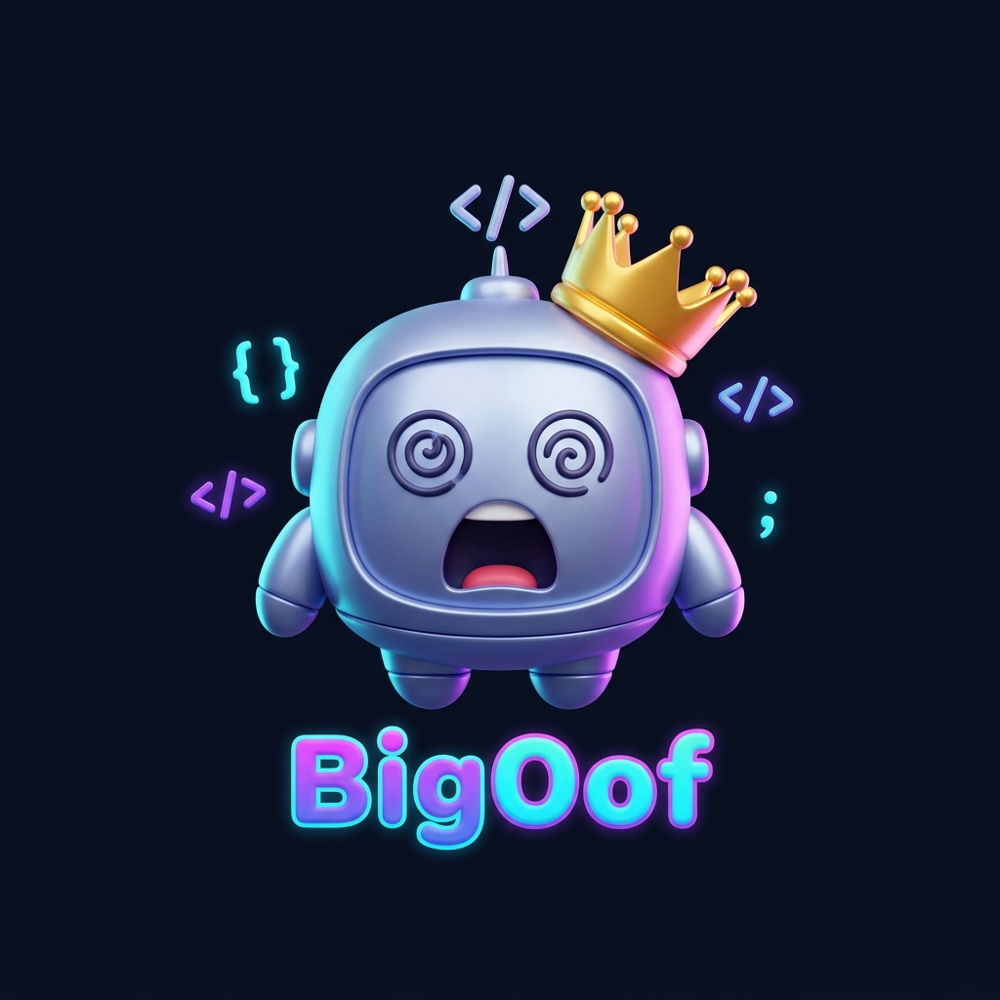
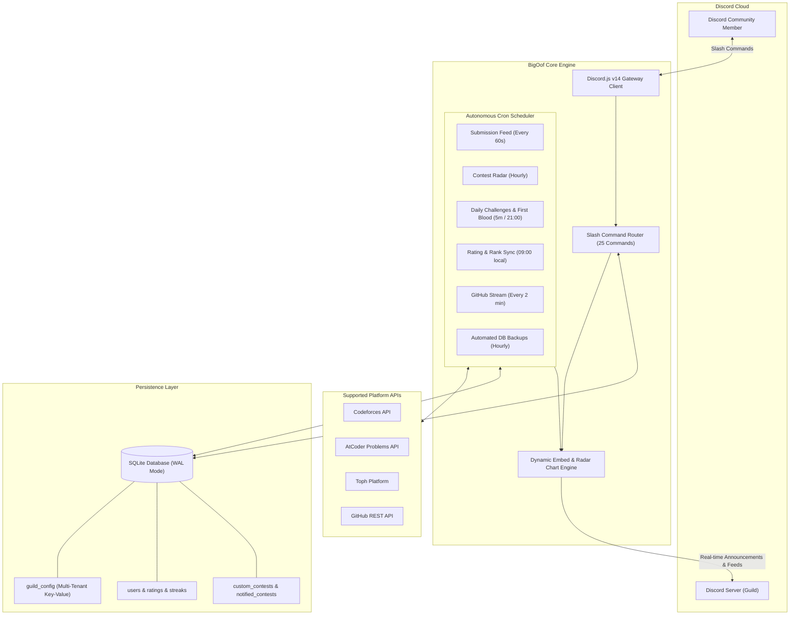

<div align="center">
  
  <h1>🎉 BigOof — Competitive Programming Discord Bot</h1>
  <p><b>An autonomous, multi-tenant Discord companion for competitive programmers, coding clubs, and ICPC teams.</b><br>
  <i>Because every O(n²) solution ends in a Big Oof 💀</i></p>

  <p>
    <a href="https://discord.js.org/"></a>
    <a href="https://nodejs.org/">=18.0.0-green?logo=node.js&logoColor=white" alt="Node.js" /></a>
    <a href="https://github.com/WiseLibs/better-sqlite3"></a>
    <a href="https://www.docker.com/"></a>
    <a href="LICENSE"></a>
  </p>
</div>

---

## 📖 Table of Contents

- [💡 What is BigOof?](#-what-is-bigoof)
- [🤔 How Does It Work for You or Other Users?](#-how-does-it-work-for-you-or-other-users)
- [🏛 System Architecture](#-system-architecture)
- [✨ Key Features](#-key-features)
  - [⚡ 60s Live Submission Tracker](#-60s-live-submission-tracker)
  - [📊 Dynamic Dashboard & Leaderboard](#-dynamic-dashboard--leaderboard)
  - [🩸 Daily Challenges & First Blood Race](#-daily-challenges--first-blood-race)
  - [📅 Contest Radar & Countdown Pings](#-contest-radar--countdown-pings)
  - [⚔️ 1v1 & Multiplayer Duels (`/vs`)](#️-1v1--multiplayer-duels-vs)
  - [🏁 Virtual Contests (`/vc`)](#-virtual-contests-vc)
  - [🤖 ICPC Team Builder & Skill Radar](#-icpc-team-builder--skill-radar)
  - [🐙 GitHub Developer Feed](#-github-developer-feed)
- [📚 Command Reference (25 Slash Commands)](#-command-reference)
  - [👤 Profile & Account Management](#-profile--account-management)
  - [📈 Discovery & Problem Solving](#-discovery--problem-solving)
  - [🎮 Duels & Competitions](#-duels--competitions)
  - [⚙️ Server Administration](#️-server-administration)
  - [🔒 Bot Owner Operations](#-bot-owner-operations)
- [🚀 Complete Setup & Installation Guide (Step-by-Step)](#-complete-setup--installation-guide-step-by-step)
  - [Prerequisites](#prerequisites)
  - [Step 1: Create Your Bot Application on Discord Portal](#step-1-create-your-bot-application-on-discord-portal)
  - [Step 2: Clone the Repository & Install Dependencies](#step-2-clone-the-repository--install-dependencies)
  - [Step 3: Configure Your Environment (`.env`)](#step-3-configure-your-environment-env)
  - [Step 4: Register Slash Commands & Launch](#step-4-register-slash-commands--launch)
  - [Step 5: Initial In-Discord Server Setup (Important!)](#step-5-initial-in-discord-server-setup-important)
- [☁️ 24/7 Production Deployment](#️-247-production-deployment)
  - [Option A: Docker & Docker Compose (Recommended)](#option-a-docker--docker-compose-recommended)
  - [Option B: Linux VPS with pm2](#option-b-linux-vps-with-pm2)
- [🗄 Database Architecture](#-database-architecture)
- [❓ Frequently Asked Questions & Troubleshooting](#-frequently-asked-questions--troubleshooting)
- [🤝 Contributing](#-contributing)
- [📜 License](#-license)

---

## 💡 What is BigOof?

Every competitive programmer knows the feeling:

> *You spend 45 minutes coding a solution during a contest.*  
> *You submit.*  
> *"Running on test 2..."*  
> **Verdict: Time Limit Exceeded on Test 2 (1001 ms).**  
> *You whisper to your monitor:* **"Big Oof."** 💀

**BigOof** is built to turn that suffering into celebration! Designed from the ground up for university clubs, ICPC teams, and coding communities, BigOof tracks your members' problem-solving journeys across **Codeforces**, **AtCoder**, **Toph**, and **GitHub** completely autonomously with zero manual spreadsheets or checks required.

---

## 🤔 How Does It Work for You or Other Users?

If anyone in the world wants to use **BigOof** for their Discord server, what do they do?

Because BigOof is an **open-source self-hostable bot**, anyone can run their own instance in just 5 minutes:
1. **Clone the Code:** They clone this GitHub repository (`git clone https://github.com/Pri8899/BigOof.git`).
2. **Create a Free Bot Application:** They create a bot in the [Discord Developer Portal](https://discord.com/developers/applications) and copy their bot token.
3. **Paste Credentials into `.env`:** They put their token and ID into `.env`.
4. **Run `npm start` (or Docker):** The bot connects to Discord and comes online in their server!
5. **Multi-Tenant Magic:** BigOof automatically isolates every server. If 10 different servers use the same bot, each server configures its own channels, rank roles, and feeds without any cross-server data leaks!

---

## 🏛 System Architecture



---

## ✨ Key Features

### ⚡ 60s Live Submission Tracker
- Automatically polls Codeforces, AtCoder, and Toph for Accepted (`AC`) verdicts every 60 seconds.
- Posts a celebratory feed embed featuring problem tags, runtime, memory consumption, and difficulty rating.
- Automatically increments solving streaks and updates rank tier roles.

### 📊 Dynamic Dashboard & Leaderboard
- Maintains a pinned live dashboard in your server's chosen channel.
- Automatically syncs all 10 official Codeforces rank tiers (from **Newbie** up to **Legendary Grandmaster**).
- Command `/leaderboard` displays real-time server rankings sorted by rating, solved count, or active daily streak.

### 🩸 Daily Challenges & First Blood Race
- Every evening at 9:00 PM (local timezone), BigOof selects curated problems tailored to your community's rating bracket.
- **First Blood 🩸:** The first member to solve any daily problem triggers an immediate server celebration.
- Celebrates daily sweeps when ambitious coders solve all problems in the set.

### 📅 Contest Radar & Countdown Pings
- Scrapes and aggregates upcoming contests across Codeforces, AtCoder, Toph, plus server-specific custom rounds.
- Dispatches countdown notification pings **24 hours** and **1 hour** before each contest starts.

### ⚔️ 1v1 & Multiplayer Duels (`/vs`)
- Challenge friends or server rivals to real-time coding duels!
- Specify rating target (e.g. 1400) and duration (e.g. 30m).
- BigOof picks an unsolved problem, starts the timer, watches the judge, and announces the winner the moment an Accepted verdict arrives.

### 🏁 Virtual Contests (`/vc`)
- Run simulated ICPC/Div rounds right inside Discord.
- BigOof assembles a balanced problem set, tracks active participants, and tallies the final standings upon round conclusion.

### 🤖 ICPC Team Builder & Skill Radar
- **Skill Radar (`/skills`):** Plots an RPG-style radar sheet of topic masteries (DP, Graph Theory, Number Theory, Trees, Greedy, Geometry, Strings).
- **ICPC Team Builder (`/build-teams`):** Uses diversity matching heuristics to construct balanced 3-person teams with complementary algorithmic strengths.

### 🐙 GitHub Developer Feed
- Keeps track of members' public commits, repository creations, and pull requests.
- Never misses a beat when your community is shipping software!

---

## 📚 Command Reference

BigOof features **25 unified slash commands** with zero duplicates:

### 👤 Profile & Account Management

| Command | Options | Description |
|---|---|---|
| `/link` | `platform`, `handle` | Links your Codeforces, AtCoder, Toph, or GitHub account. |
| `/unlink` | `platform` | Unlinks an account from your Discord profile. |
| `/profile` | `user` *(optional)* | View comprehensive CP profile card with ratings, solves, badges, and streaks. |
| `/solved` | `user` *(optional)* | Visual breakdown of Codeforces solves by difficulty division (Div 1 through Div 4). |
| `/github` | `user` *(optional)* | Displays GitHub statistics, top repositories, recent commits, and contribution metrics. |

### 📈 Discovery & Problem Solving

| Command | Options | Description |
|---|---|---|
| `/leaderboard` | None | Shows the server leaderboard ranked by rating, solves, or active streaks. |
| `/contests` | `platform` *(optional)* | Upcoming contests radar (All, Codeforces, AtCoder, Toph, Custom). |
| `/graph` | `platform`, `user` *(optional)* | Generates a visual rating progress line chart. |
| `/skills` | `user` *(optional)* | Generates an RPG topic mastery radar sheet (DP, Math, Graphs, etc.). |
| `/whosolved` | `problem_link` | Finds every server member who has solved a given problem. |
| `/suggest` | `rating` *(optional)*, `tag` *(optional)* | Recommends an unsolved Codeforces problem tailored to your rating. |
| `/ask-help` | `problem`, `details` *(optional)* | Asks community members for hints or assistance on a problem. |
| `/help` | None | Interactive command directory with category dropdowns. |

### 🎮 Duels & Competitions

| Command | Options | Description |
|---|---|---|
| `/vs create` | `rating`, `duration`, `tag` *(optional)* | Creates a new Versus duel lobby. |
| `/vs join` | `match_id` | Joins an open Versus match. |
| `/vs start` | `match_id` | Starts the duel and reveals the problem. |
| `/vs cancel` | `match_id` | Cancels a pending duel lobby. |
| `/vc start` | `duration`, `difficulty` | Launches a server-wide Virtual Contest round. |
| `/vc status` | None | Displays the remaining time and standings for the active Virtual Contest. |
| `/vc end` | None | Concludes the active Virtual Contest and calculates final standings. |
| `/build-teams` | None | Generates balanced 3-person ICPC teams based on members' strengths. |

### ⚙️ Server Administration
*Requires `Administrator` or `Manage Server` permission.*

| Command | Options | Description |
|---|---|---|
| `/set-channel` | `feature`, `channel` | Configures target channel for `feed`, `dashboard`, `contest`, `rating`, `suggest`, `github`, `backup`, or `general`. |
| `/view-channels` | None | Displays all configured bot channels for this server. |
| `/setup-roles` | None | Automatically creates and configures the base `CP` role, all 10 Codeforces rank roles (with official colors), and streak milestone roles. |
| `/custom-contest` | `action` (add / edit / delete / list), ... | Manages custom server contests included in radar embeds and pings. |
| `/force-unlink` | `target`, `platform` | Unlinks an account on behalf of a server member and updates the dashboard. |
| `/announce` | `message`, `channel` *(optional)*, `ping` *(optional)* | Broadcasts a formatted announcement embed with optional `@everyone` mention. |

### 🔒 Bot Owner Operations
*Strictly restricted to the `OWNER_ID` defined in your environment.*

| Command | Options | Description |
|---|---|---|
| `/set-bot` | `action` (avatar / username), `image` *(optional)*, `url` *(optional)*, `name` *(optional)* | Updates the bot application's avatar image or username across Discord. |
| `/backupdb` | None | Manually triggers an immediate database backup to the backup channel. |
| `/restoredb` | `source` (latest / attachment) | Restores the database from a backup snapshot. |

---

## 🚀 Complete Setup & Installation Guide (Step-by-Step)

Follow this complete guide to set up and run BigOof from scratch.

### Prerequisites

Before starting, ensure you have:
- **Node.js**: Version `18.0.0` or higher. Check via `node -v`.
- **Git**: Installed on your system. Check via `git --version`.
- **A Discord Account & Server**: Where you have Administrator permissions.

---

### Step 1: Create Your Bot Application on Discord Portal

1. Open the **[Discord Developer Portal](https://discord.com/developers/applications)**.
2. Click the blue **New Application** button in the top right.
3. Enter the name **BigOof**, accept the Developer Terms, and click **Create**.
4. **Set Avatar & Copy Client ID:**
   - Under **General Information**, click on the App Icon placeholder and upload [`assets/bot-avatar.png`](assets/bot-avatar.png).
   - Locate **Application ID** and click **Copy**. Save this as your `CLIENT_ID`.
5. **Get Bot Token & Enable Intents:**
   - On the left sidebar, click **Bot**.
   - Under the username, click **Reset Token** (confirm with your 2FA code if prompted).
   - Click **Copy** to copy your new token. Save this as your `DISCORD_TOKEN`. *(Never share this token publicly!)*
   - Scroll down to the **Privileged Gateway Intents** section:
     - ✅ Enable **Server Members Intent** *(mandatory for role syncing and leaderboards)*.
     - ✅ Enable **Message Content Intent** *(mandatory for problem link parsing)*.
   - Click **Save Changes** at the bottom of the page.
6. **Generate the Bot Invite Link:**
   - On the left sidebar, click **OAuth2 > URL Generator**.
   - Under **Scopes**, select:
     - `bot`
     - `applications.commands`
   - Under **Bot Permissions**, select:
     - `Administrator` *(recommended for full channel and role management)*.
   - Copy the generated URL at the bottom, paste it into a browser tab, choose your Discord server, and click **Authorize**.

---

### Step 2: Clone the Repository & Install Dependencies

Open your terminal and run:

```bash
# 1. Clone the repository
git clone https://github.com/Pri8899/BigOof.git

# 2. Enter the project folder
cd BigOof

# 3. Install required npm packages
npm install
```

---

### Step 3: Configure Your Environment (`.env`)

Create your `.env` configuration file by copying the template:

```bash
cp .env.example .env
```

Open `.env` in any text editor and fill in your values:

```env
# Paste the token copied from Step 1.5:
DISCORD_TOKEN=your_bot_token_here

# Paste the Application ID copied from Step 1.4:
CLIENT_ID=your_application_id_here

# Your own Discord User ID (gives you access to /backupdb, /restoredb, /set-bot):
OWNER_ID=your_discord_user_id_here

# Optional: Set your test server ID here for INSTANT command updates during dev.
# Leave blank to deploy commands globally across all servers.
GUILD_ID=

# Optional: Timezone for daily challenges and weekly summaries (defaults to UTC):
# Examples: UTC, America/New_York, Asia/Dhaka, Europe/London
TIMEZONE=UTC
```

> **Tip (How to get your `OWNER_ID`):**  
> In Discord, go to **User Settings > Advanced > enable Developer Mode**. Then right-click your own profile in any chat and select **Copy User ID**.

---

### Step 4: Register Slash Commands & Launch

1. **Deploy Slash Commands to Discord:**
   ```bash
   npm run deploy
   ```
   *You should see:* `✅ Slash commands registered successfully!`

2. **(Optional) Set Bot Profile Avatar:**
   ```bash
   npm run set-avatar
   ```
   *This automatically uploads the included cute mascot avatar directly to Discord.*

3. **Start BigOof:**
   ```bash
   npm start
   ```
   *For live development with auto-reload on file edits:*
   ```bash
   npm run dev
   ```

---

### Step 5: Initial In-Discord Server Setup (Important!)

Once BigOof is online in your server, execute these 3 quick setup steps:

1. **Adjust Discord Role Hierarchy (Crucial):**
   - Go to your Discord server's **Server Settings > Roles**.
   - Drag the **BigOof** role **ABOVE** the rank roles and members.
   - *Why?* Discord security prohibits bots from assigning roles that sit higher than the bot's own highest role!
2. **Auto-Generate Server Roles:**
   - In any channel, run:
     ```
     /setup-roles
     ```
   - BigOof will instantly create the base `CP` role, all 10 Codeforces rank tiers with official colors (`Legendary Grandmaster` down to `Newbie`), and 3 streak milestone roles (`💫 30+ Day`, `👑 15+ Day`, `🔥 7+ Day`).
3. **Configure Announcement Channels:**
   - **Option A (Super Easy — 1 Single Channel for Everything):**
     If you only have one bot channel and want all feeds to go there, run:
     ```
     /set-channel feature:All Features channel:#cp-bot
     ```
     *(This automatically routes submissions, leaderboards, contests, rating alerts, and daily challenges into that single channel with one click!)*
   - **Option B (Custom Dedicated Channels):**
     If your server has separate channels, route them individually:
     ```
     /set-channel feature:feed channel:#submissions
     /set-channel feature:dashboard channel:#leaderboard
     /set-channel feature:contest channel:#contests
     ```
   - Run `/view-channels` at any time to inspect your active channel routing!
4. **Link Your Account:**
   - Run `/link platform:Codeforces handle:your_handle` to connect your coding profile!

---

## ☁️ 24/7 Production Deployment

### Option A: Docker & Docker Compose (Recommended)

BigOof includes a production-grade multi-stage `Dockerfile` and `docker-compose.yml`.

1. Ensure your `.env` is configured.
2. Launch the container in the background:
   ```bash
   docker compose up -d
   ```
3. View live logs:
   ```bash
   docker compose logs -f
   ```

All database files and persistent data are automatically saved to `./data/bigoof.db` on your host machine.

### Option B: Linux VPS with pm2

To run BigOof as a continuous background daemon on Ubuntu / Debian / CentOS:

```bash
# 1. Install pm2 globally
npm install -g pm2

# 2. Start BigOof under pm2 management
pm2 start index.js --name "bigoof"

# 3. Configure pm2 to auto-start on server reboot
pm2 save
pm2 startup
```

---

## 🗄 Database Architecture

BigOof uses **SQLite** through `better-sqlite3` configured in **WAL (Write-Ahead Logging)** mode for lightning-fast concurrent operations.

| Table | Purpose |
|---|---|
| `guild_config` | Multi-tenant key-value store (`(guild_id, key)`) keeping all server configurations isolated. |
| `users` | Maps Discord User IDs to Codeforces, AtCoder, Toph, and GitHub handles. |
| `ratings` | Caches current and peak ratings, platform ranks, and solved counts. |
| `streaks` | Tracks active daily solving streaks and all-time records. |
| `daily_problems` | Caches daily challenge problem sets, solvers, and first blood records. |
| `vs_matches` & `vs_participants` | Manages live 1v1 and multiplayer duel lobbies, problems, and submission timers. |
| `virtual_contests` | Manages server-wide simulated contest rounds and scoreboards. |
| `custom_contests` | Admin-defined contests featured in the radar and countdown alerts. |
| `notified_contests` | Deduplication store preventing redundant contest reminder pings. |
| `processed_submissions` | Deduplication store ensuring Accepted verdicts are never announced twice. |
| `processed_github_commits` | Deduplication store ensuring GitHub commits are never announced twice. |

---

## ❓ Frequently Asked Questions & Troubleshooting

### Q: `An invalid token was provided.`
> **Fix:** In the [Discord Developer Portal](https://discord.com/developers/applications) > your application > **Bot**, click **Reset Token**, copy the freshly generated token, and paste it into `DISCORD_TOKEN` in `.env` without extra spaces or quotes.

### Q: Slash commands do not show up in my Discord server.
> **Fix:** Run `npm run deploy`. If `GUILD_ID` is left empty in `.env`, Discord registers commands globally, which may take up to an hour to propagate across Discord's CDN. For instant testing in your server, set `GUILD_ID=your_server_id` in `.env` and rerun `npm run deploy`.

### Q: The bot cannot assign rank or streak roles (`Missing Permissions`).
> **Fix:** In Discord **Server Settings > Roles**, drag the **BigOof** role **above** the rank roles (`Legendary Grandmaster`, `CP`, etc.). Discord prohibits bots from modifying roles positioned higher than their own highest role.

### Q: Solving streaks reset at the wrong time of day.
> **Fix:** Set your local timezone in `.env` (e.g. `TIMEZONE=Asia/Dhaka` or `TIMEZONE=America/New_York`). Daily streaks calculate against your local midnight.

---

## 🤝 Contributing

Contributions are warmly welcomed from the open-source community!

1. Fork the Project.
2. Create your Feature Branch:
   ```bash
   git checkout -b feature/EpicFeature
   ```
3. Commit your Changes:
   ```bash
   git commit -m 'feat: Add EpicFeature'
   ```
4. Push to the Branch:
   ```bash
   git push origin feature/EpicFeature
   ```
5. Open a Pull Request.

---

## 📜 License

Distributed under the **MIT License**. See [`LICENSE`](LICENSE) for details.
