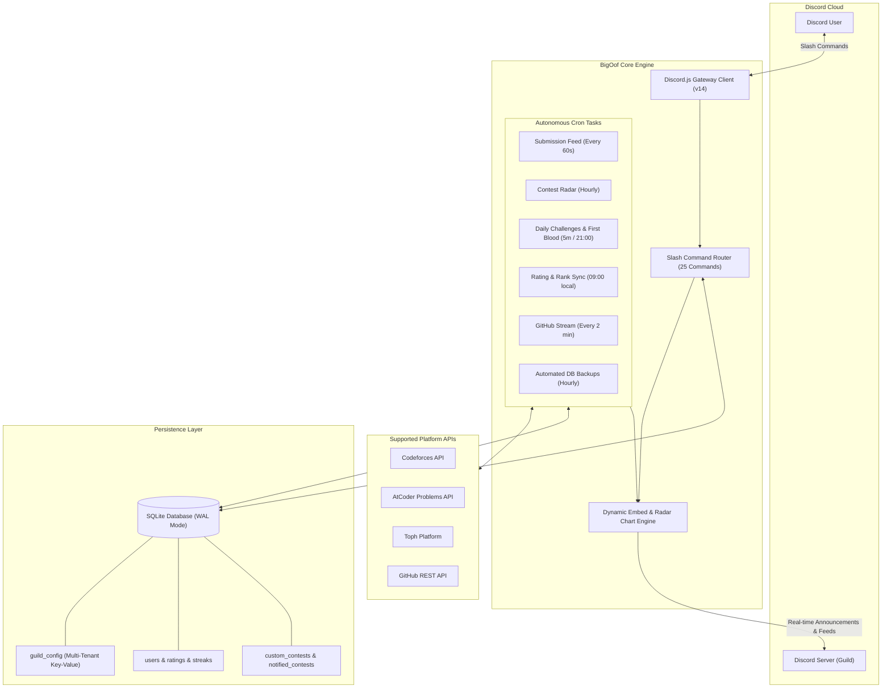

<div align="center">
  
  <h1>💀 BigOof — Competitive Programming Discord Bot</h1>
  <p><b>An autonomous, multi-tenant Discord companion for competitive programmers, coding clubs, and ICPC teams.</b><br>
  <i>Because every O(n²) solution ends in a Big Oof.</i></p>

  <p>
    <a href="https://discord.js.org/"></a>
    <a href="https://nodejs.org/">=18.0.0-green?logo=node.js&logoColor=white" alt="Node.js" /></a>
    <a href="https://github.com/WiseLibs/better-sqlite3"></a>
    <a href="https://www.docker.com/"></a>
    <a href="LICENSE"></a>
  </p>
</div>

---

## 📖 Table of Contents

- [The Story of BigOof](#-the-story-of-bigoof)
- [System Architecture](#-system-architecture)
- [Key Features](#-key-features)
  - [⚡ 60s Live Submission Tracker](#-60s-live-submission-tracker)
  - [📊 Dynamic Dashboard & Leaderboard](#-dynamic-dashboard--leaderboard)
  - [🩸 Daily Challenges & First Blood Race](#-daily-challenges--first-blood-race)
  - [📅 Contest Radar & Smart Countdown Alerts](#-contest-radar--smart-countdown-alerts)
  - [⚔️ 1v1 / Multiplayer Codeforces Duels (`/vs`)](#️-1v1--multiplayer-codeforces-duels-vs)
  - [🏁 Server-Wide Virtual Contests (`/vc`)](#-server-wide-virtual-contests-vc)
  - [🤖 ICPC Team Builder & Skill Radar](#-icpc-team-builder--skill-radar)
  - [🐙 GitHub Developer Feed](#-github-developer-feed)
- [Command Reference (25 Slash Commands)](#-command-reference)
  - [👤 Profile & Account Management](#-profile--account-management)
  - [📈 Discovery & Problem Solving](#-discovery--problem-solving)
  - [🎮 Duels & Competitions](#-duels--competitions)
  - [⚙️ Server Administration](#️-server-administration)
  - [🔒 Bot Owner Operations](#-bot-owner-operations)
- [Setup & Installation from Scratch](#-setup--installation-from-scratch)
  - [Step 1: Create Your Bot on Discord Portal](#step-1-create-your-bot-on-discord-portal)
  - [Step 2: Clone & Configure](#step-2-clone--configure)
  - [Step 3: Deploy Slash Commands](#step-3-deploy-slash-commands)
  - [Step 4: Launch BigOof](#step-4-launch-bigoof)
- [Production Deployment](#-production-deployment)
  - [Docker & Docker Compose (Recommended)](#docker--docker-compose-recommended)
  - [Linux VPS with pm2](#linux-vps-with-pm2)
- [Database Architecture](#-database-architecture)
- [Frequently Asked Questions & Troubleshooting](#-frequently-asked-questions--troubleshooting)
- [Contributing](#-contributing)
- [License](#-license)

---

## 💡 The Story of BigOof

Every competitive programmer knows the feeling:

> *You spend 45 minutes coding a solution during a Div. 2 round.*  
> *You submit.*  
> *"Running on test 2..."*  
> **Verdict: Time Limit Exceeded on Test 2 (1001 ms).**  
> *You whisper to your monitor:* **"Big Oof."** 💀

**BigOof** is built to turn that suffering into celebration! Designed from the ground up for university clubs, ICPC teams, and coding communities, BigOof tracks your members' problem-solving journeys across **Codeforces**, **AtCoder**, **Toph**, and **GitHub** completely autonomously with zero manual spreadsheets or checks required.

---

## 🏛 System Architecture

BigOof is built on an enterprise-grade multi-tenant architecture: every Discord server manages its own channels, rank roles, and feeds without any cross-server interference.



---

## ✨ Key Features

### ⚡ 60s Live Submission Tracker
- Automatically polls Codeforces, AtCoder, and Toph for Accepted (`AC`) verdicts every 60 seconds.
- Posts a celebratory feed embed featuring problem tags, runtime, memory consumption, and difficulty rating.
- Automatically increments solving streaks and updates rank tier roles.

### 📊 Dynamic Dashboard & Leaderboard
- Maintains a pinned live dashboard in your server's chosen channel.
- Automatically syncs all 10 official Codeforces rank tiers (from **Newbie** up to **Legendary Grandmaster**).
- Command `/leaderboard` displays real-time server rankings sorted by rating, solved count, or active daily streak.

### 🩸 Daily Challenges & First Blood Race
- Every evening at 9:00 PM (local timezone), BigOof selects curated problems tailored to your community's rating bracket.
- **First Blood 🩸:** The first member to solve any daily problem triggers an immediate server celebration.
- Celebrates daily sweeps when ambitious coders solve all problems in the set.

### 📅 Contest Radar & Smart Countdown Alerts
- Scrapes and aggregates upcoming contests across Codeforces, AtCoder, Toph, plus server-specific custom rounds.
- Dispatches countdown notification pings **24 hours** and **1 hour** before each contest starts.

### ⚔️ 1v1 / Multiplayer Codeforces Duels (`/vs`)
- Challenge friends or server rivals to real-time coding duels!
- Specify rating target (e.g. 1400) and duration (e.g. 30m).
- BigOof picks an unsolved problem, starts the timer, watches the judge, and announces the winner the moment an Accepted verdict arrives.

### 🏁 Server-Wide Virtual Contests (`/vc`)
- Run simulated ICPC/Div rounds right inside Discord.
- BigOof assembles a balanced problem set, tracks active participants, and tallies the final standings upon round conclusion.

### 🤖 ICPC Team Builder & Skill Radar
- **Skill Radar (`/skills`):** Plots an RPG-style radar sheet of topic masteries (DP, Graph Theory, Number Theory, Trees, Greedy, Geometry, Strings).
- **ICPC Team Builder (`/build-teams`):** Uses diversity matching heuristics to construct balanced 3-person teams with complementary algorithmic strengths.

### 🐙 GitHub Developer Feed
- Keeps track of members' public commits, repository creations, and pull requests.
- Never misses a beat when your community is shipping software!

---

## 📚 Command Reference

BigOof features **25 unified slash commands** with zero duplicates:

### 👤 Profile & Account Management

| Command | Options | Description |
|---|---|---|
| `/link` | `platform`, `handle` | Links your Codeforces, AtCoder, Toph, or GitHub account. |
| `/unlink` | `platform` | Unlinks an account from your Discord profile. |
| `/profile` | `user` *(optional)* | View comprehensive CP profile card with ratings, solves, badges, and streaks. |
| `/solved` | `user` *(optional)* | Visual breakdown of Codeforces solves by difficulty division (Div 1 through Div 4). |
| `/github` | `user` *(optional)* | Displays GitHub statistics, top repositories, recent commits, and contribution metrics. |

### 📈 Discovery & Problem Solving

| Command | Options | Description |
|---|---|---|
| `/leaderboard` | None | Shows the server leaderboard ranked by rating, solves, or active streaks. |
| `/contests` | `platform` *(optional)* | Upcoming contests radar (All, Codeforces, AtCoder, Toph, Custom). |
| `/graph` | `platform`, `user` *(optional)* | Generates a visual rating progress line chart. |
| `/skills` | `user` *(optional)* | Generates an RPG topic mastery radar sheet (DP, Math, Graphs, etc.). |
| `/whosolved` | `problem_link` | Finds every server member who has solved a given problem. |
| `/suggest` | `rating` *(optional)*, `tag` *(optional)* | Recommends an unsolved Codeforces problem tailored to your rating. |
| `/ask-help` | `problem`, `details` *(optional)* | Asks community members for hints or assistance on a problem. |
| `/help` | None | Interactive command directory with category dropdowns. |

### 🎮 Duels & Competitions

| Command | Options | Description |
|---|---|---|
| `/vs create` | `rating`, `duration`, `tag` *(optional)* | Creates a new Versus duel lobby. |
| `/vs join` | `match_id` | Joins an open Versus match. |
| `/vs start` | `match_id` | Starts the duel and reveals the problem. |
| `/vs cancel` | `match_id` | Cancels a pending duel lobby. |
| `/vc start` | `duration`, `difficulty` | Launches a server-wide Virtual Contest round. |
| `/vc status` | None | Displays the remaining time and standings for the active Virtual Contest. |
| `/vc end` | None | Concludes the active Virtual Contest and calculates final standings. |
| `/build-teams` | None | Generates balanced 3-person ICPC teams based on members' strengths. |

### ⚙️ Server Administration
*Requires `Administrator` or `Manage Server` permission.*

| Command | Options | Description |
|---|---|---|
| `/set-channel` | `feature`, `channel` | Configures target channel for `feed`, `dashboard`, `contest`, `rating`, `suggest`, `github`, `backup`, or `general`. |
| `/view-channels` | None | Displays all configured bot channels for this server. |
| `/setup-roles` | None | Automatically creates and configures the base `CP` role, all 10 Codeforces rank roles (with official colors), and streak milestone roles. |
| `/custom-contest` | `action` (add / edit / delete / list), ... | Manages custom server contests included in radar embeds and pings. |
| `/force-unlink` | `target`, `platform` | Unlinks an account on behalf of a server member and updates the dashboard. |
| `/announce` | `message`, `channel` *(optional)*, `ping` *(optional)* | Broadcasts a formatted announcement embed with optional `@everyone` mention. |

### 🔒 Bot Owner Operations
*Strictly restricted to the `OWNER_ID` defined in your environment.*

| Command | Options | Description |
|---|---|---|
| `/set-bot` | `action` (avatar / username), `image` *(optional)*, `url` *(optional)*, `name` *(optional)* | Updates the bot application's avatar image or username across Discord. |
| `/backupdb` | None | Manually triggers an immediate database backup to the backup channel. |
| `/restoredb` | `source` (latest / attachment) | Restores the database from a backup snapshot. |

---

## 🚀 Setup & Installation from Scratch

Follow these 4 simple steps to get BigOof up and running:

### Step 1: Create Your Bot on Discord Portal

1. Go to the **[Discord Developer Portal](https://discord.com/developers/applications)**.
2. Click **New Application**, enter the name **BigOof**, and click **Create**.
3. Under **General Information**:
   - Upload [`assets/bot-avatar.png`](assets/bot-avatar.png) as your **App Icon**.
   - Copy the **Application ID** (this will be your `CLIENT_ID`).
4. Click the **Bot** tab on the left menu:
   - Click **Reset Token** and copy the generated token (this will be your `DISCORD_TOKEN`).
   - Scroll down to **Privileged Gateway Intents** and enable both:
     - ✅ **Server Members Intent** *(needed to sync member roles and calculate server leaderboards)*
     - ✅ **Message Content Intent** *(needed for problem link parsing and channel interactions)*
5. Click **OAuth2 > URL Generator**:
   - Under **Scopes**: check `bot` and `applications.commands`.
   - Under **Bot Permissions**: check `Administrator` (or *Manage Roles*, *Send Messages*, *Embed Links*, *Attach Files*, *Read Message History*).
   - Copy the generated URL, open it in your browser, and invite BigOof to your Discord server!

### Step 2: Clone & Configure

Clone the repository and install dependencies:

```bash
git clone https://github.com/Pri8899/BigOof.git
cd BigOof
npm install
```

Copy the environment template:

```bash
cp .env.example .env
```

Open `.env` and fill in your credentials:

```env
DISCORD_TOKEN=your_copied_bot_token_here
CLIENT_ID=your_copied_application_id_here
OWNER_ID=your_personal_discord_user_id_here

# Leave blank to deploy slash commands globally across all servers:
GUILD_ID=

# Optional: Timezone (e.g. UTC, Asia/Dhaka, America/New_York)
TIMEZONE=UTC
```

*(To get your `OWNER_ID`: in Discord, go to User Settings > Advanced > enable Developer Mode, then right-click your own profile and select **Copy User ID**).*

### Step 3: Deploy Slash Commands

Register all 25 slash commands with Discord:

```bash
npm run deploy
```

*(Tip: When `GUILD_ID` is set in `.env`, commands update instantly in that test server. When `GUILD_ID` is left empty, commands register globally across all servers).*

### Step 4: Launch BigOof

```bash
npm start
```

For live development with auto-reloading:

```bash
npm run dev
```

Once online in your server, run:
1. `/setup-roles` to create your community's CP, Rank, and Streak roles.
2. `/set-channel` to point the feeds to your preferred channels.
3. `/link` to connect your coding handles!

---

## ☁️ Production Deployment

### Docker & Docker Compose (Recommended)

BigOof includes a production-grade multi-stage `Dockerfile` and `docker-compose.yml`.

1. Ensure your `.env` is configured.
2. Launch the container:
   ```bash
   docker compose up -d
   ```
3. View logs:
   ```bash
   docker compose logs -f
   ```

All database data is automatically persisted in `./data/bigoof.db` on your host machine.

### Linux VPS with pm2

To run BigOof as a continuous background daemon on any Linux VPS (Ubuntu/Debian):

```bash
npm install -g pm2
pm2 start index.js --name "bigoof"
pm2 save
pm2 startup
```

---

## 🗄 Database Architecture

BigOof uses **SQLite** through `better-sqlite3` configured in **WAL (Write-Ahead Logging)** mode for lightning-fast concurrent operations.

| Table | Purpose |
|---|---|
| `guild_config` | Multi-tenant key-value store (`(guild_id, key)`) keeping all server configurations isolated. |
| `users` | Maps Discord User IDs to Codeforces, AtCoder, Toph, and GitHub handles. |
| `ratings` | Caches current and peak ratings, platform ranks, and solved counts. |
| `streaks` | Tracks active daily solving streaks and all-time records. |
| `daily_problems` | Caches daily challenge problem sets, solvers, and first blood records. |
| `vs_matches` & `vs_participants` | Manages live 1v1 and multiplayer duel lobbies, problems, and submission timers. |
| `virtual_contests` | Manages server-wide simulated contest rounds and scoreboards. |
| `custom_contests` | Admin-defined contests featured in the radar and countdown alerts. |
| `notified_contests` | Deduplication store preventing redundant contest reminder pings. |
| `processed_submissions` | Deduplication store ensuring Accepted verdicts are never announced twice. |
| `processed_github_commits` | Deduplication store ensuring GitHub commits are never announced twice. |

---

## ❓ Frequently Asked Questions & Troubleshooting

### Q: `An invalid token was provided.`
> **Fix:** When creating or resetting your bot on the Discord Developer Portal, make sure you clicked **Reset Token**, copied the fresh token, and pasted it into `DISCORD_TOKEN` in `.env` without extra spaces or quotes.

### Q: The bot cannot assign rank or streak roles (`Missing Permissions`).
> **Fix:** In your Discord server's **Server Settings > Roles**, drag the **BigOof** role **above** the rank and streak roles (`Legendary Grandmaster`, `CP`, etc.). Discord prohibits bots from managing roles placed higher than their own highest role.

### Q: How do I change the bot's avatar from Discord?
> **Fix:** Either run `npm run set-avatar` in your terminal or use the owner slash command `/set-bot avatar`. You can also upload `assets/bot-avatar.png` directly in the Discord Developer Portal.

---

## 🤝 Contributing

Contributions are warmly welcomed!

1. Fork the Project.
2. Create your Feature Branch:
   ```bash
   git checkout -b feature/EpicFeature
   ```
3. Commit your Changes:
   ```bash
   git commit -m 'feat: Add EpicFeature'
   ```
4. Push to the Branch:
   ```bash
   git push origin feature/EpicFeature
   ```
5. Open a Pull Request.

---

## 📜 License

Distributed under the **MIT License**. See [`LICENSE`](LICENSE) for details.
