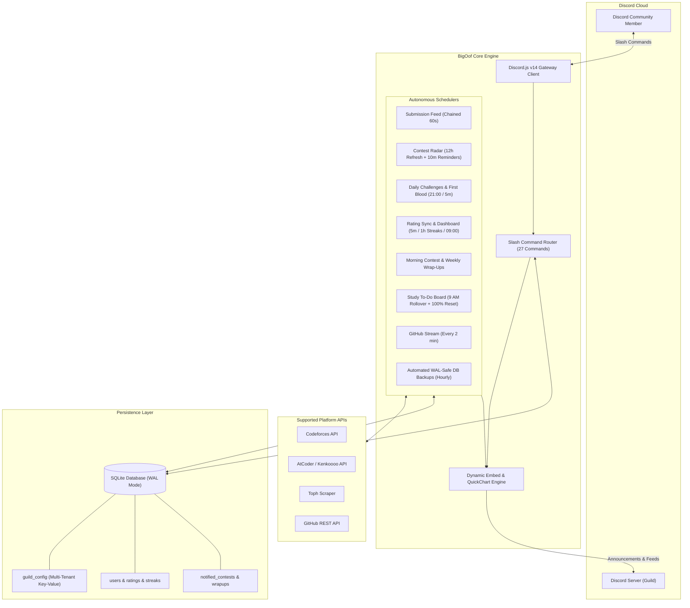

<div align="center">
  
  <h1>🎉 BigOof — Competitive Programming Discord Bot</h1>
  <p><b>An autonomous, multi-tenant Discord companion for competitive programmers, coding clubs, and ICPC teams.</b><br>
  <i>Because every O(n²) solution ends in a Big Oof 💀</i></p>

  <p>
    <a href="https://discord.js.org/"></a>
    <a href="https://nodejs.org/">=18.0.0-green?logo=node.js&logoColor=white" alt="Node.js" /></a>
    <a href="https://github.com/WiseLibs/better-sqlite3"></a>
    <a href="https://www.docker.com/"></a>
    <a href="LICENSE"></a>
  </p>
</div>

---

## 📖 Table of Contents

- [💡 What is BigOof?](#-what-is-bigoof)
- [🏛 System Architecture](#-system-architecture)
- [✨ Key Features](#-key-features)
- [📚 Command Reference (27 Slash Commands)](#-command-reference-27-slash-commands)
- [🚀 Complete Setup & Installation Guide](#-complete-setup--installation-guide)
- [☁️ 24/7 Production Deployment](#️-247-production-deployment)
- [🗄 Database Architecture](#-database-architecture)
- [❓ Frequently Asked Questions & Troubleshooting](#-frequently-asked-questions--troubleshooting)
- [📜 License](#-license)

---

## 💡 What is BigOof?

**BigOof** is a self-hostable, multi-tenant Competitive Programming Discord bot built for university coding clubs and ICPC teams. It tracks **Codeforces**, **AtCoder**, **Toph**, and **GitHub** activity autonomously with zero spreadsheets required:

- Live Accepted (`AC`) submission feed, rating shift alerts, solving streaks, and automated Discord rank/streak roles.
- Autonomous contest schedules with 24h / 1h countdown alerts and daily 9:00 AM post-contest upsolve wrap-ups.
- Interactive in-Discord duels (`/vs` 3x3 Battle Grid & Classic Race), simulated Virtual Contests (`/vc`), skill trees (`/skills`), and ICPC squad matchmaking (`/build-teams`).
- Strict per-guild channel isolation (`guild_config`) so multiple Discord servers running one bot instance stay cleanly separated.

---

## 🏛 System Architecture



---

## ✨ Key Features

- **⚡ Live Submission Tracker:** Polls Codeforces, AtCoder, and Toph every 60s (chained safely to prevent overlaps) and posts solved embeds permanently to your General/Feed channel with problem tags, difficulty, and Codeforces/AtCoder execution telemetry.
- **📊 Dynamic Dashboard & Leaderboard:** Replaces the leaderboard embed with a fresh snapshot whenever ratings/solves change (plus 9:00 AM daily), alongside automatic **CP**, Codeforces Rank tier (`Newbie` → `Legendary Grandmaster`), and Streak milestone (`7d` → `2+ yr`) roles.
- **🩸 Daily Challenges & First Blood:** Replaces yesterday's daily quest embed with 5 fresh progressive challenges at 9:00 PM local time, and posts First Blood / Daily Sweep celebrations permanently in your General channel.
- **✅ Interactive Study To-Do Board:** Maintains a live Study To-Do form in your `#study-todo` channel (`/set-channel feature:✅ Study To-Do`) where any member can add unlimited subjects with study details (*how much to study*), edit items, and side-tick (`✅`) what they complete (locking finished items per user; removing items is Admin-only). Finishing a form at 100% deletes it and spawns a fresh form immediately; if any member still hasn't completed it by **9:00 AM** the next day, the old form remains with **only `✅ Tick Done` allowed** (`Add`/`Edit`/`Remove` locked) while a brand-new form posts at **9:00 AM**.
- **🌅 Contest Wrap-up & Upsolve Radar:** At 9:00 AM daily, recaps finished Codeforces rounds in your server's wrapup/general channel and identifies each contender's exact upsolve roadblock (e.g., `WA on test 4`, `TLE on test 2`). On-demand `/wrapup` also supported.
- **⏰ Contest Radar & Auto-Expiring 24h/1h Reminders:** Aggregates upcoming contests across Codeforces, AtCoder, Toph, and server custom contests (`/custom-contest`), replacing the radar overview every 12 hours, rendering dynamic date-matching calendar badges (`NOV 27`, `DEC 01`, etc.) across reminders, schedules, daily challenges, and Study To-Do boards via Discord Application Emojis, and automatically deleting 24h/1h reminder alerts once each contest finishes.
- **⚔️ 3x3 Battle Grid & Duels (`/vs`):** Real-time 1v1 or multiplayer 9-problem Battle Grid (1st AC scores 100%, later solves score 1/3) or Classic time-decay race, synced every 15 seconds with lock protection.
- **🏁 Persistent Virtual Contests (`/vc`):** Simulated individual or multi-team Codeforces rounds with restart recovery and contest-window timestamp verification.
- **🐙 GitHub Stream:** Tracks live commits, multi-commit bursts, PRs, releases, branches, and forks in real time via repository push monitoring (`/users/:user/repos?sort=pushed` + `/commits`) paired with ETag caching, baseline cursor seeding, and accurate commit timestamps (link via `/link`, view cards & 24h manual sync via `/github`, supports `GITHUB_TOKEN` for 5,000 req/hr).

---

## 📚 Command Reference (27 Slash Commands)

### 👤 Profile & Account Management

| Command | Options | Description |
|---|---|---|
| `/link` | `platform`, `handle` | Link your Codeforces, AtCoder, Toph, or GitHub account. |
| `/unlink` | `platform` | Unlink a connected account from your Discord profile. |
| `/profile` | `member` *(optional)* | View a profile card with ratings, solves, rank badges, and streaks. |
| `/compare` | `user1`, `user2`, `handle1`, `handle2` | Head-to-head comparison (rating, peak, solves, overlap, duel H2H). |
| `/solved` | `member` *(optional)* | Breakdown of Codeforces solves by division (Div 1 through Div 4). |
| `/github` | `profile` / `sync` | View GitHub developer cards and trigger manual activity sync (link/unlink via `/link` & `/unlink`). |

### 📈 Discovery & Problem Solving

| Command | Options | Description |
|---|---|---|
| `/leaderboard` | None | Show the live server leaderboard for current server members. |
| `/contests` | `platform` *(optional)* | View upcoming contests (All, Codeforces, AtCoder, Toph, Custom). |
| `/wrapup` | `contest` *(optional)*, `broadcast` *(optional)* | View Codeforces contest standings & your upsolve roadblock. |
| `/graph` | `platform`, `member` *(optional)* | Generate a QuickChart rating trajectory line graph. |
| `/skills` | `member` *(optional)* | RPG skill sheet analyzing mastery across algorithm domains. |
| `/whosolved` | `link` | Find current server members who solved a given Codeforces problem URL. |
| `/suggest` | `tag`, `rating`, `div`, `problems` *(all optional)* | Suggest unsolved Codeforces problems tailored to your filters. |
| `/ask-help` | `problem`, `image1`..`image5` *(optional)* | Request community hints with optional code/screenshot images. |
| `/announce` | `channel`, `mode`, `ping` *(all optional)* | Post a clean Formal Card (`card`) or Paste Whole Thing (`paste`) with an optional hidden-URL button (Members: Announcements & Useful Links only; Admins: any channel). |
| `/help` | None | Interactive command directory with category selector menu. |

### 🎮 Duels & Competitions

| Command | Options | Description |
|---|---|---|
| `/vs` | `rating`, `mode`, `tag`, `duration`, `problems`, `division` | Start a 3x3 Battle Grid or Classic Race duel lobby. |
| `/vc` | `start`, `status`, `end` | Run persistent individual or team Virtual Contest rounds. |
| `/build-teams` | None | Auto-generate balanced 3-person ICPC squads from CF ratings & tags. |

### ⚙️ Server Administration & Bot Owner Operations

| Command | Options | Access | Description |
|---|---|---|---|
| `/set-channel` | `feature`, `channel` | Manage Server | Route feeds/dashboards to dedicated channels (or **All Features**). |
| `/view-channels` | None | Manage Server | Inspect configured channels for the current server. |
| `/setup-roles` | None | Manage Roles | Create and sync `CP`, CF Rank tiers, and Streak milestone roles (`7d` through `2+ yr`). |
| `/custom-contest` | `add` / `edit` / `delete` / `list` | Manage Channels | Manage custom server contests on the radar & reminder schedule. |
| `/force-unlink` | `member`, `platform` *(optional)* | Manage Server | Forcefully unlink or purge a member's accounts. |
| `/set-bot` | `avatar` / `username` | Bot Owner | Update the bot avatar or username on Discord. |
| `/backupdb` | None | Bot Owner | Upload a WAL-consistent `bigoof-backup-*.db` snapshot immediately. |
| `/restoredb` | `source` (`latest`/`upload`), `database` | Bot Owner | Validate & restore the SQLite DB live from backup or attachment. |

---

## 🚀 Complete Setup & Installation Guide

### Prerequisites
- **Node.js** `>= 18.0.0` (LTS v20/v22 recommended)
- **Git**

### Step 1: Discord Developer Portal & Bot Setup

1. **Create the App & Copy `CLIENT_ID`:**
   - Go to [discord.com/developers/applications](https://discord.com/developers/applications) and click **New Application**.
   - Under **General Information**, copy the **Application ID** (this is your `CLIENT_ID`).
   - *(Optional)* Upload `assets/bot-avatar.png` as the App Icon, add a **Description** (up to 400 chars — supports `[Add Bot](invite_url)` masked links), and add up to 5 **Tags**.
2. **Configure the Bot & Copy `DISCORD_TOKEN` (Required):**
   - Open **Bot** in the left sidebar → click **Reset Token** and copy your token (this is your `DISCORD_TOKEN` — keep it secret and never share it in screenshots or commits).
   - Scroll down to **Privileged Gateway Intents** and turn **ON** **Server Members Intent**, then click **Save Changes** *(required — without this, the bot crashes on login)*.
3. **Configure Native Profile "Add App" Button *(Optional)*:**
   - Open **Installation** → under *Installation Contexts*, keep **Guild Install** enabled and uncheck **User Install** (BigOof is a server bot).
   - Keep **Install Link** set to **Discord Provided Link**.
   - Under **Default Install Settings → Guild Install**, add Scopes `bot` + `applications.commands`, select **Administrator** (or the permissions below) under **Permissions**, and click **Save Changes**.
4. **Invite the Bot to Your Server:**
   - Open **OAuth2 → URL Generator**.
   - Under **Scopes**, check both `bot` and `applications.commands`.
   - Keep **Integration Type** as `Guild Install`.
   - Under **Bot Permissions**, check **Administrator** *(easiest for club servers)*, or select minimal permissions: `View Channels`, `Manage Roles`, `Send Messages`, `Embed Links`, `Attach Files`, `Read Message History`, `Manage Messages`, `Mention Everyone`, and *(optional)* `Create Expressions` / `Manage Expressions`.
   - Open the generated URL at the bottom, pick your server, and click **Authorize**.
5. **Copy Your `OWNER_ID`:**
   - In Discord, open **User Settings → Advanced** and turn **ON** **Developer Mode**.
   - Close Settings (`Esc`), click your avatar/username at the **bottom-left** of Discord (or right-click yourself in a server's member list) → **Copy User ID**.

### Step 2: Install & Configure Environment Variables

```bash
git clone https://github.com/Pri8899/BigOof.git
cd BigOof
npm install
cp .env.example .env
```

Edit `.env` (or your host's environment variables):

- **Required before boot** *(the bot cannot start or locate persistent storage without these)*:
  - `DISCORD_TOKEN` — bot token from Step 1
  - `CLIENT_ID` — Application ID from Step 1
  - `OWNER_ID` — your Discord User ID (enables `/backupdb`, `/restoredb`, `/set-bot`, and backup channel config)
  - `DATABASE_PATH` — custom SQLite path if using a persistent volume (e.g. `/data/bigoof.db`)
  - `TIMEZONE` — IANA timezone such as `UTC`, `Asia/Dhaka`, or `Asia/Kolkata` *(controls 9:00 AM / 9:00 PM cron schedules, midnight streak rollovers, and `/custom-contest` inputs; platform contest countdowns always use Discord Unix timestamps so every user sees their own local time)*
- **Optional** *(leave blank if not needed — all `*_CHANNEL_ID` settings can be configured inside Discord via `/set-channel`)*:
  - `GITHUB_TOKEN` — increases GitHub API limit from 60 to 5,000 req/hr
  - `GUILD_ID` — register slash commands to a single server instantly during testing (leave blank for global registration)

### Step 3: Deploy Commands, Start & Configure in Discord

```bash
npm run deploy
npm start
```

> `npm start` runs `node deploy-commands.js && node index.js`, so slash commands stay synced on every start.

Inside your Discord server:
1. Open **Server Settings → Roles** and make sure the **BigOof** bot role sits **above** `CP`, Codeforces rank, and streak roles so role assignment succeeds.
2. Run `/set-channel feature:All Features channel:#cp-bot` (or bind individual channels per feature, including `#study-todo` via `feature:✅ Study To-Do` and `#useful-links` via `feature:🔗 Useful Links`).
3. Run `/setup-roles` to create and sync `CP`, rank, and streak roles.
4. Link your profiles with `/link platform:Codeforces handle:your_handle` (plus `AtCoder`, `Toph`, and `GitHub`).
   - *Migrating an existing database?* Run `/restoredb source:Upload a .db file manually` and attach your `.db` file directly in Discord.

---

## ☁️ 24/7 Production Deployment

### Railway (Cloud Hosting with Persistent Volume)

1. Create a new project on [Railway](https://railway.com/) from your GitHub repo (Railway automatically builds using `Dockerfile`).
2. Right-click the service canvas (or open service settings) and attach a **Volume**:
   - **Mount Path:** `/data`
   - **Size:** `500 MB` is plenty for SQLite + WAL files
   - **Replicas:** Keep at `1 Replica` (enforced for attached volumes and required by SQLite)
3. Open **Variables** and configure your startup variables:
   - **Important:** Mounting `/data` alone does **not** move the database — you must set `DATABASE_PATH=/data/bigoof.db` or SQLite will write to ephemeral container storage and reset on redeploy.
   - Use **`{} Raw Editor`** (recommended — Railway's *Suggested Variables* scanned from `.env.example` are unsaved drafts until confirmed with **`✓ Add`**, and placeholder `your_...` text will crash startup):
     ```env
     DISCORD_TOKEN=your_bot_token
     CLIENT_ID=your_application_id
     OWNER_ID=your_discord_user_id
     DATABASE_PATH=/data/bigoof.db
     TIMEZONE=UTC
     ```
     *(Replace `UTC` with your IANA timezone such as `Asia/Dhaka` if desired. All `*_CHANNEL_ID` variables can be omitted and configured later in Discord with `/set-channel`.)*
4. Click **Update Variables**, then click **Deploy** in the top banner.
5. Open **Deployments → View Logs** and verify you see `Total: 27 command(s)` and `✅ Bot online as ...`.

### Docker & Docker Compose

```bash
docker compose up -d
docker compose logs -f
```

Persistent SQLite data is stored on the host in `./data/bigoof.db` (`DATABASE_PATH=/data/bigoof.db`).

### PM2 (Linux / macOS / Windows)

```bash
npm install -g pm2
npm run deploy
pm2 start index.js --name "bigoof"
pm2 save
```

---

## 🗄 Database Architecture

BigOof persists state in SQLite (`bigoof.db` by default, or `DATABASE_PATH`) using **WAL mode**:

| Table | Purpose |
|---|---|
| `guild_config` | Per-server configuration (`(guild_id, key)`) and host global settings |
| `users` | Discord IDs mapped to Codeforces, AtCoder, Toph, and GitHub handles |
| `ratings` & `rating_history` | Cached ratings, peaks, solved counts, and chronological rating history |
| `streaks` | Current & max daily activity streaks across platforms |
| `daily_problems` | Daily challenge problem sets, First Blood owners, and Daily Sweeps |
| `vs_matches` & `vs_participants` | Live Battle Grid & Classic Race state, tile locks, scores, and attempts |
| `virtual_contests` & `vc_participants` | Persistent Virtual Contests with timer recovery |
| `notified_contests` | Upcoming platform + Custom contests and 24h / 1h alert tracking |
| `contest_wrapups` | Per-guild finished-round wrap-up deduplication |
| `weekly_snapshots` | Sunday baseline snapshots for delta rating/solve digests |
| `study_forms`, `study_items` & `study_ticks` | Active Study To-Do forms, tasks, and per-user completion ticks |
| `processed_submissions` & `processed_github_commits` | Submission & GitHub event deduplication |

---

## ❓ Frequently Asked Questions & Troubleshooting

- **Container crashes on boot with `DISCORD_TOKEN is missing or invalid`:** Ensure `DISCORD_TOKEN` and `CLIENT_ID` are saved under **Service Variables** (not left as `your_...` placeholders or unsaved *Suggested Variables*) and keep the token on a single line with no quotes.
- **Login fails with `DisallowedIntents`:** Enable **Server Members Intent** under **Discord Developer Portal → Bot → Privileged Gateway Intents** and click **Save Changes**.
- **Data resets after a Railway redeploy:** Confirm your Volume is mounted at `/data` AND `DATABASE_PATH=/data/bigoof.db` is saved in Railway **Variables**.
- **Slash commands don't appear immediately:** Leave `GUILD_ID` blank for global commands (first propagation on Discord can take up to ~1 hour), or set `GUILD_ID` to your server ID for instant registration.
- **Role assignment fails (`Missing Permissions`):** Ensure the bot has **Manage Roles** and the **BigOof** role sits above `CP`, rank, and streak roles in **Server Settings → Roles**.
- **GitHub feed stops updating (`403`):** Add a personal access token to `GITHUB_TOKEN` to raise limits from 60 to 5,000 requests/hour.

---

## 📜 License

Distributed under the **MIT License**. See [`LICENSE`](LICENSE) for details.
