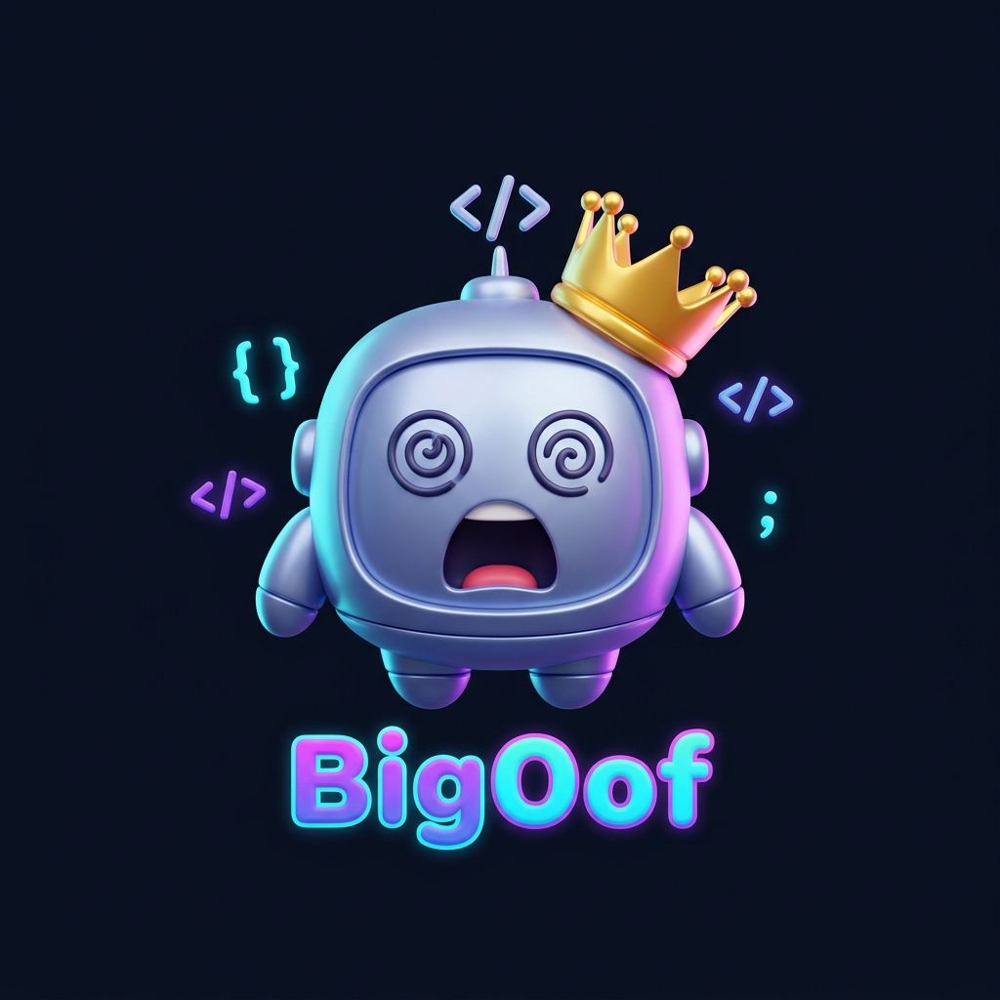
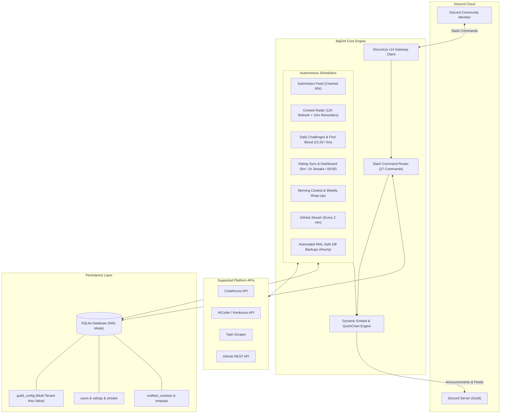

<div align="center">
  
  <h1>🎉 BigOof — Competitive Programming Discord Bot</h1>
  <p><b>An autonomous, multi-tenant Discord companion for competitive programmers, coding clubs, and ICPC teams.</b><br>
  <i>Because every O(n²) solution ends in a Big Oof 💀</i></p>

  <p>
    <a href="https://discord.js.org/"></a>
    <a href="https://nodejs.org/">=18.0.0-green?logo=node.js&logoColor=white" alt="Node.js" /></a>
    <a href="https://github.com/WiseLibs/better-sqlite3"></a>
    <a href="https://www.docker.com/"></a>
    <a href="LICENSE"></a>
  </p>
</div>

---

## 📖 Table of Contents

- [💡 What is BigOof?](#-what-is-bigoof)
- [🏛 System Architecture](#-system-architecture)
- [✨ Key Features](#-key-features)
- [📚 Command Reference (27 Slash Commands)](#-command-reference-27-slash-commands)
- [🚀 Complete Setup & Installation Guide](#-complete-setup--installation-guide)
- [☁️ 24/7 Production Deployment](#️-247-production-deployment)
- [🗄 Database Architecture](#-database-architecture)
- [❓ Frequently Asked Questions & Troubleshooting](#-frequently-asked-questions--troubleshooting)
- [📜 License](#-license)

---

## 💡 What is BigOof?

**BigOof** is a self-hostable, multi-tenant Competitive Programming Discord bot built for university coding clubs and ICPC teams. It tracks **Codeforces**, **AtCoder**, **Toph**, and **GitHub** activity autonomously with zero spreadsheets required:

- Live Accepted (`AC`) submission feed, rating shift alerts, solving streaks, and automated Discord rank/streak roles.
- Autonomous contest schedules with 24h / 1h countdown alerts and daily 9:00 AM post-contest upsolve wrap-ups.
- Interactive in-Discord duels (`/vs` 3x3 Battle Grid & Classic Race), simulated Virtual Contests (`/vc`), skill trees (`/skills`), and ICPC squad matchmaking (`/build-teams`).
- Strict per-guild channel isolation (`guild_config`) so multiple Discord servers running one bot instance stay cleanly separated.

---

## 🏛 System Architecture



---

## ✨ Key Features

- **⚡ Live Submission Tracker:** Polls Codeforces, AtCoder, and Toph every 60s (chained safely to prevent overlaps) and posts solved embeds with problem tags, difficulty, and Codeforces/AtCoder execution telemetry.
- **📊 Dynamic Dashboard & Leaderboard:** Auto-updating leaderboard in your chosen channel alongside automatic **CP**, Codeforces Rank tier (`Newbie` → `Legendary Grandmaster`), and Streak milestone (`7d` / `15d` / `30d`) roles.
- **🩸 Daily Challenges & First Blood:** Posts 5 progressive daily challenges at 9:00 PM local time and crowns First Blood / Daily Sweep winners every 5 minutes.
- **🌅 Contest Wrap-up & Upsolve Radar:** At 9:00 AM daily, recaps finished Codeforces rounds in your server's wrapup/general channel and identifies each contender's exact upsolve roadblock (e.g., `WA on test 4`, `TLE on test 2`). On-demand `/wrapup` also supported.
- **📅 Contest Radar & 24h/1h Reminders:** Aggregates upcoming contests across Codeforces, AtCoder, Toph, and server custom contests (`/custom-contest`), refreshing silently every 12 hours and sending 24-hour and 1-hour alerts.
- **⚔️ 3x3 Battle Grid & Duels (`/vs`):** Real-time 1v1 or multiplayer 9-problem Battle Grid (1st AC scores 100%, later solves score 1/3) or Classic time-decay race, synced every 15 seconds with lock protection.
- **🏁 Persistent Virtual Contests (`/vc`):** Simulated individual or multi-team Codeforces rounds with restart recovery and contest-window timestamp verification.
- **🐙 GitHub Stream:** Tracks public commits, PRs, releases, branches, and forks via `/github` (supports `GITHUB_TOKEN` for 5,000 req/hr).

---

## 📚 Command Reference (27 Slash Commands)

### 👤 Profile & Account Management

| Command | Options | Description |
|---|---|---|
| `/link` | `platform`, `handle` | Link your Codeforces, AtCoder, Toph, or GitHub account. |
| `/unlink` | `platform` | Unlink a connected account from your Discord profile. |
| `/profile` | `member` *(optional)* | View a profile card with ratings, solves, rank badges, and streaks. |
| `/compare` | `user1`, `user2`, `handle1`, `handle2` | Head-to-head comparison (rating, peak, solves, overlap, duel H2H). |
| `/solved` | `member` *(optional)* | Breakdown of Codeforces solves by division (Div 1 through Div 4). |
| `/github` | `link` / `profile` / `sync` / `unlink` | Manage GitHub linking, developer cards, and manual activity sync. |

### 📈 Discovery & Problem Solving

| Command | Options | Description |
|---|---|---|
| `/leaderboard` | None | Show the live server leaderboard for current server members. |
| `/contests` | `platform` *(optional)* | View upcoming contests (All, Codeforces, AtCoder, Toph, Custom). |
| `/wrapup` | `contest` *(optional)*, `broadcast` *(optional)* | View Codeforces contest standings & your upsolve roadblock. |
| `/graph` | `platform`, `member` *(optional)* | Generate a QuickChart rating trajectory line graph. |
| `/skills` | `member` *(optional)* | RPG skill sheet analyzing mastery across algorithm domains. |
| `/whosolved` | `link` | Find current server members who solved a given Codeforces problem URL. |
| `/suggest` | `tag`, `rating`, `div`, `problems` *(all optional)* | Suggest unsolved Codeforces problems tailored to your filters. |
| `/ask-help` | `problem`, `image1`..`image5` *(optional)* | Request community hints with optional code/screenshot images. |
| `/help` | None | Interactive command directory with category selector menu. |

### 🎮 Duels & Competitions

| Command | Options | Description |
|---|---|---|
| `/vs` | `rating`, `mode`, `tag`, `duration`, `problems`, `division` | Start a 3x3 Battle Grid or Classic Race duel lobby. |
| `/vc` | `start`, `status`, `end` | Run persistent individual or team Virtual Contest rounds. |
| `/build-teams` | None | Auto-generate balanced 3-person ICPC squads from CF ratings & tags. |

### ⚙️ Server Administration & Bot Owner Operations

| Command | Options | Access | Description |
|---|---|---|---|
| `/set-channel` | `feature`, `channel` | Manage Server | Route feeds/dashboards to dedicated channels (or **All Features**). |
| `/view-channels` | None | Manage Server | Inspect configured channels for the current server. |
| `/setup-roles` | None | Manage Roles | Create and sync `CP`, CF Rank tiers, and Streak milestone roles. |
| `/custom-contest` | `add` / `edit` / `delete` / `list` | Manage Channels | Manage custom server contests on the radar & reminder schedule. |
| `/force-unlink` | `member`, `platform` *(optional)* | Manage Server | Forcefully unlink or purge a member's accounts. |
| `/announce` | `channel` *(optional)* | Mention Everyone | Open an announcement modal and broadcast with `@everyone`. |
| `/set-bot` | `avatar` / `username` | Bot Owner | Update the bot avatar or username on Discord. |
| `/backupdb` | None | Bot Owner | Upload a WAL-consistent `bigoof-backup-*.db` snapshot immediately. |
| `/restoredb` | `source` (`latest`/`upload`), `database` | Bot Owner | Validate & restore the SQLite DB live from backup or attachment. |

---

## 🚀 Complete Setup & Installation Guide

### Prerequisites
- **Node.js** `>= 18.0.0` (LTS v20/v22 recommended)
- **Git**

### Step 1: Discord Developer Portal
1. Create a new application at [discord.com/developers/applications](https://discord.com/developers/applications).
2. Under **General Information**, copy the **Application ID** (`CLIENT_ID`).
3. Under **Bot**, generate/copy your **Token** (`DISCORD_TOKEN`) and enable **Server Members Intent** under **Privileged Gateway Intents**.
4. Under **OAuth2 → URL Generator**, select scopes `bot` + `applications.commands` and invite the bot to your server.

### Step 2: Install & Configure

```bash
git clone https://github.com/Pri8899/BigOof.git
cd BigOof
npm install
cp .env.example .env
```

Edit `.env`:
- Set `DISCORD_TOKEN`, `CLIENT_ID`, and `OWNER_ID`.
- Optionally set `GITHUB_TOKEN` (increases GitHub API limit from 60 to 5,000 req/hr), `TIMEZONE` (e.g., `Asia/Dhaka`, `Asia/Kolkata`, `UTC`), and `GUILD_ID` (for instant guild command registration).

### Step 3: Deploy Commands & Start

```bash
npm run deploy
npm start
```

Inside Discord:
1. Drag the **BigOof** bot role above rank/streak roles in **Server Settings → Roles**.
2. Run `/setup-roles`.
3. Run `/set-channel feature:All Features channel:#cp-bot` (or configure dedicated channels individually).
4. Link your account with `/link platform:Codeforces handle:your_handle`.

---

## ☁️ 24/7 Production Deployment

### Docker & Docker Compose

```bash
docker compose up -d
docker compose logs -f
```

Persistent SQLite data is stored on the host in `./data/bigoof.db` (`DATABASE_PATH=/data/bigoof.db`).

### PM2 (Linux / macOS / Windows)

```bash
npm install -g pm2
npm run deploy
pm2 start index.js --name "bigoof"
pm2 save
```

---

## 🗄 Database Architecture

BigOof persists state in SQLite (`bigoof.db` by default, or `DATABASE_PATH`) using **WAL mode**:

| Table | Purpose |
|---|---|
| `guild_config` | Per-server configuration (`(guild_id, key)`) and host global settings |
| `users` | Discord IDs mapped to Codeforces, AtCoder, Toph, and GitHub handles |
| `ratings` & `rating_history` | Cached ratings, peaks, solved counts, and chronological rating history |
| `streaks` | Current & max daily activity streaks across platforms |
| `daily_problems` | Daily challenge problem sets, First Blood owners, and Daily Sweeps |
| `vs_matches` & `vs_participants` | Live Battle Grid & Classic Race state, tile locks, scores, and attempts |
| `virtual_contests` & `vc_participants` | Persistent Virtual Contests with timer recovery |
| `notified_contests` | Upcoming platform + Custom contests and 24h / 1h alert tracking |
| `contest_wrapups` | Per-guild finished-round wrap-up deduplication |
| `weekly_snapshots` | Sunday baseline snapshots for delta rating/solve digests |
| `processed_submissions` & `processed_github_commits` | Submission & GitHub event deduplication |

---

## ❓ Frequently Asked Questions & Troubleshooting

- **Slash commands don't appear immediately:** Set `GUILD_ID` in `.env` during testing and run `npm run deploy`; global command propagation on Discord can take up to an hour.
- **Role assignment fails (`Missing Permissions`):** Ensure the bot has **Manage Roles** and its role sits higher in **Server Settings → Roles** than `CP`, rank, and streak roles.
- **GitHub feed stops updating (`403`):** Add a personal access token to `GITHUB_TOKEN` in `.env` to raise limits from 60 to 5,000 requests/hour.

---

## 📜 License

Distributed under the **MIT License**. See [`LICENSE`](LICENSE) for details.
