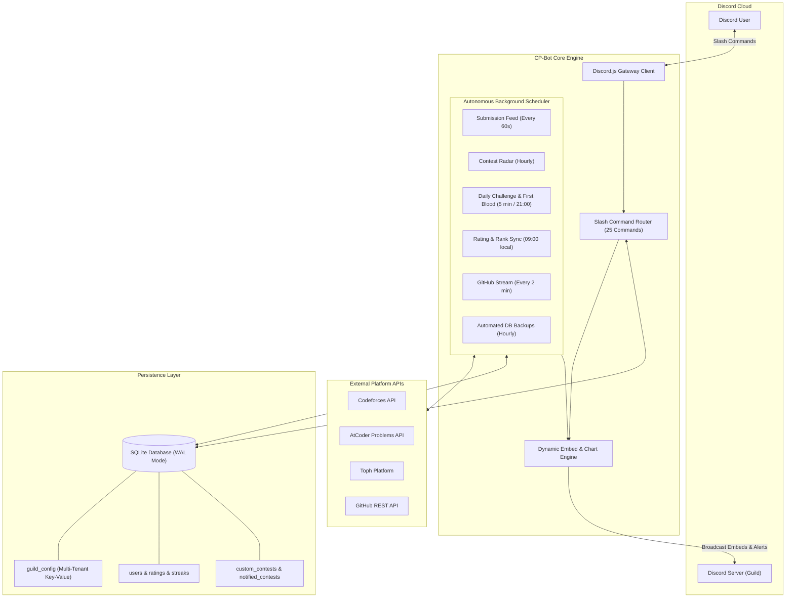

<div align="center">
  
  <h1>🏆 Competitive Programming Discord Bot</h1>
  <p><b>An autonomous, multi-tenant Discord companion for competitive programming clubs, university communities, and ICPC teams.</b></p>

  <p>
    <a href="https://discord.js.org/"></a>
    <a href="https://nodejs.org/">=18.0.0-green?logo=node.js&logoColor=white" alt="Node.js" /></a>
    <a href="https://github.com/WiseLibs/better-sqlite3"></a>
    <a href="https://www.docker.com/"></a>
    <a href="LICENSE"></a>
  </p>
</div>

---

## 📖 Table of Contents

- [Overview](#-overview)
- [System Architecture](#-system-architecture)
- [Key Features](#-key-features)
  - [⚡ Live Submission Tracker](#-live-submission-tracker)
  - [📊 Dynamic Dashboard & Leaderboard](#-dynamic-dashboard--leaderboard)
  - [🩸 Daily Challenges & First Blood](#-daily-challenges--first-blood)
  - [📅 Contest Radar & Smart Countdown Alerts](#-contest-radar--smart-countdown-alerts)
  - [⚔️ Codeforces Duels & Virtual Contests](#️-codeforces-duels--virtual-contests)
  - [🤖 ICPC Team Builder & Skill Radar](#-icpc-team-builder--skill-radar)
  - [🐙 GitHub Developer Feed](#-github-developer-feed)
- [Command Reference](#-command-reference)
  - [👤 User & Profile Commands](#-user--profile-commands)
  - [📈 Discovery & Statistics](#-discovery--statistics)
  - [🎮 Versus & Virtual Contests](#-versus--virtual-contests)
  - [⚙️ Server Administration](#️-server-administration)
  - [🔒 Bot Owner Operations](#-bot-owner-operations)
- [Installation & Setup](#-installation--setup)
  - [1. Discord Developer Portal Setup](#1-discord-developer-portal-setup)
  - [2. Local Setup](#2-local-setup)
  - [3. Setting the Bot Avatar & Profile](#3-setting-the-bot-avatar--profile)
  - [4. Deploying Slash Commands](#4-deploying-slash-commands)
- [Production Deployment](#-production-deployment)
  - [Option A: Docker & Docker Compose (Recommended)](#option-a-docker--docker-compose-recommended)
  - [Option B: Railway / PaaS](#option-b-railway--paas)
  - [Option C: Linux VPS with pm2](#option-c-linux-vps-with-pm2)
- [Configuration Reference](#-configuration-reference)
- [Database Architecture](#-database-architecture)
- [Troubleshooting & FAQ](#-troubleshooting--faq)
- [Contributing](#-contributing)
- [License](#-license)

---

## 🌟 Overview

**CP-Bot** is an open-source, production-ready Discord bot engineered specifically for competitive programmers and university coding clubs. Built with **Discord.js v14**, **SQLite (via `better-sqlite3`)**, and an autonomous multi-task background scheduler, it tracks coding journeys across **Codeforces**, **AtCoder**, **Toph**, and **GitHub** with zero manual intervention required.

Designed from the ground up with a **multi-tenant architecture**: any Discord server can invite the bot and configure its own channels, role tiers, and alert preferences independently without any cross-server data leaks or hardcoded channel bindings.

---

## 🏛 System Architecture



---

## ✨ Key Features

### ⚡ Live Submission Tracker
- Continuously polls Codeforces, AtCoder, and Toph for newly submitted solutions.
- When an `AC` (Accepted) verdict is verified, the bot broadcasts a celebratory announcement embed to the server's configured feed channel with problem tags, runtime, memory, and difficulty rating.
- Automatically calculates and updates the solver's active daily solving streak.

### 📊 Dynamic Dashboard & Leaderboard
- Maintains a live, pinned dashboard in your designated channel.
- Displays server members categorized by official Codeforces rank tiers (Newbie to Legendary Grandmaster) and active streaks.
- Supports `/leaderboard` on-demand with sorting by rating, solves count, or active daily streak.

### 🩸 Daily Challenges & First Blood
- Posts a curated problem set every evening tailored to your server's average rating range.
- **First Blood 🩸:** The first community member to submit an Accepted solution on Codeforces is recognized with a special instant celebration embed.
- Tracks daily problem sweeps when members solve all daily challenges.

### 📅 Contest Radar & Smart Countdown Alerts
- Aggregates upcoming contest schedules across Codeforces, AtCoder, Toph, and admin-added custom contests.
- Keeps a pinned radar embed in your contest channel.
- Automatically dispatches countdown reminder pings **24 hours** and **1 hour** prior to contest start.

### ⚔️ Codeforces Duels & Virtual Contests
- **Versus Mode (`/vs`):** Start 1v1 or multiplayer programming duels. Players receive a problem matched to their target difficulty and race to submit an Accepted solution within the time limit.
- **Virtual Contests (`/vc`):** Organize server-wide simulated contest rounds featuring balanced problemsets, live timers, and post-round scoreboards.

### 🤖 ICPC Team Builder & Skill Radar
- **Skill Radar (`/skills`):** Visualizes individual member proficiencies across algorithmic categories (Dynamic Programming, Graph Theory, Math, Data Structures, Greedy, etc.) as an RPG-style stat sheet.
- **ICPC Team Builder (`/build-teams`):** Uses diversity and complementarity heuristics to auto-form balanced 3-person teams based on solved tag profiles.

### 🐙 GitHub Developer Feed
- Monitors linked members' GitHub public activity.
- Broadcasts new repository creation, commit pushes, and pull requests to a dedicated developer channel.

---

## 📚 Command Reference

### 👤 User & Profile Commands

| Command | Options | Description |
|---|---|---|
| `/link` | `platform` (Codeforces / AtCoder / Toph / GitHub), `handle` | Links your competitive programming or GitHub account to your Discord profile. |
| `/unlink` | `platform` | Unlinks a competitive programming or GitHub account. |
| `/profile` | `user` *(optional)* | Displays ratings, max ratings, platform ranks, total solves, and current streak. |
| `/solved` | `user` *(optional)* | Visualizes Codeforces solves grouped by problem rating and difficulty bracket. |
| `/github` | `user` *(optional)* | Displays GitHub statistics, top repositories, recent commits, and contribution metrics. |

### 📈 Discovery & Statistics

| Command | Options | Description |
|---|---|---|
| `/leaderboard` | None | Displays the server leaderboard ranked by rating, solves, and active streaks. |
| `/contests` | `platform` *(optional)* | Displays upcoming contests filtered by platform (All, Codeforces, AtCoder, Toph, Custom). |
| `/graph` | `handle`, `platform` *(optional)* | Renders a visual rating progression chart over time. |
| `/skills` | `handle` | Generates a topic proficiency radar sheet (DP, Math, Graphs, Trees, Strings, etc.). |
| `/whosolved` | `problem_link` | Searches the server database to reveal all members who solved a given problem. |
| `/suggest` | `rating` *(optional)*, `tag` *(optional)* | Recommends an unsolved Codeforces problem tailored to your rating level. |
| `/ask-help` | `problem`, `details` *(optional)* | Posts a formatted help request asking community members for hints or debugging assistance. |
| `/help` | None | Interactive guide featuring category dropdowns explaining all bot features. |

### 🎮 Versus & Virtual Contests

| Command | Options | Description |
|---|---|---|
| `/vs create` | `rating`, `duration`, `tag` *(optional)* | Creates a new Versus duel lobby with custom rating and time limits. |
| `/vs join` | `match_id` | Joins an open Versus match lobby. |
| `/vs start` | `match_id` | Starts the Versus match, selects the problem, and opens the race. |
| `/vs cancel` | `match_id` | Cancels a pending Versus duel. |
| `/vc start` | `duration`, `difficulty` | Launches a server-wide Virtual Contest with a balanced problemset. |
| `/vc end` | None | Concludes the active Virtual Contest and calculates final standings. |
| `/vc status` | None | Displays the remaining time and standings for the active Virtual Contest. |
| `/build-teams` | None | Analyzes member skill sets to form balanced 3-person ICPC teams. |

### ⚙️ Server Administration
*Requires `Administrator` or `Manage Server` permission.*

| Command | Options | Description |
|---|---|---|
| `/set-channel` | `feature`, `channel` | Sets the target channel for `feed`, `dashboard`, `contest`, `rating`, `suggest`, `github`, `backup`, or `general`. |
| `/view-channels` | None | Displays all currently configured bot channels for this server. |
| `/setup-roles` | None | Automatically creates the base `CP` role, all 10 Codeforces rank tier roles (with official colors), and streak milestone roles. |
| `/custom-contest` | `action` (add / edit / delete / list), ... | Manages custom server contests included in the radar and countdown pings. |
| `/force-unlink` | `target`, `platform` | Unlinks an account on behalf of a server member and updates the server dashboard. |
| `/announce` | `message`, `channel` *(optional)*, `ping` *(optional)* | Broadcasts a formatted announcement embed with optional `@everyone` mention. |

### 🔒 Bot Owner Operations
*Strictly restricted to the `OWNER_ID` defined in your environment.*

| Command | Options | Description |
|---|---|---|
| `/set-bot` | `action` (avatar / username), `image` *(optional)*, `url` *(optional)*, `name` *(optional)* | Updates the bot application's avatar image or username across Discord. |
| `/backupdb` | None | Manually triggers an immediate database backup to the backup channel. |
| `/restoredb` | `source` (latest / attachment) | Restores the SQLite database from a backup snapshot. |

---

## 🚀 Installation & Setup

### 1. Discord Developer Portal Setup

1. Open the [Discord Developer Portal](https://discord.com/developers/applications) and create a **New Application**.
2. Navigate to the **Bot** tab:
   - Click **Reset Token** to generate a bot token and copy it.
   - Under **Privileged Gateway Intents**, enable:
     - ✅ **Server Members Intent** (required to sync member roles and calculate server leaderboards).
     - ✅ **Message Content Intent** (required for problem link parsing and channel interactions).
3. Navigate to **OAuth2 > URL Generator**:
   - Under **Scopes**: Select `bot` and `applications.commands`.
   - Under **Bot Permissions**: Select `Administrator` (or *Manage Roles*, *Send Messages*, *Embed Links*, *Attach Files*, *Read Message History*).
   - Copy the generated URL and open it in your browser to invite the bot to your server.

### 2. Local Setup

Clone the repository and install dependencies:

```bash
git clone https://github.com/Pri8899/DC-Bot.git
cd DC-Bot
npm install
```

Copy the example environment configuration:

```bash
cp .env.example .env
```

Edit `.env` with your values:

```env
# Required Discord Authentication
DISCORD_TOKEN=your_discord_bot_token_here
CLIENT_ID=your_application_client_id_here

# Bot Owner User ID (required for /set-bot, /backupdb, /restoredb)
OWNER_ID=your_personal_discord_id_here

# Deployment Scope (leave blank for global slash commands across all servers)
GUILD_ID=

# Optional: GitHub Token (raises rate limit from 60 to 5,000 requests/hour)
GITHUB_TOKEN=

# Optional: Server Timezone (defaults to UTC; e.g. Asia/Dhaka, America/New_York)
TIMEZONE=UTC
```

### 3. Setting the Bot Avatar & Profile

To set the bot's Discord profile picture to the included high-resolution branding logo:

```bash
npm run set-avatar
```

*(You can also use the `/set-bot avatar` slash command directly within Discord at any time).*

### 4. Deploying Slash Commands

Register all slash commands with Discord:

```bash
npm run deploy
```

*(Note: When `GUILD_ID` is set in `.env`, commands update instantly on that specific server. When `GUILD_ID` is left empty, commands register globally across all servers).*

Start the bot:

```bash
npm start
```

For live development with auto-reloading:

```bash
npm run dev
```

---

## ☁️ Production Deployment

### Option A: Docker & Docker Compose (Recommended)

The repository includes a production multi-stage `Dockerfile` and `docker-compose.yml`:

1. Ensure your `.env` file is configured in the project root.
2. Build and start the bot container:

```bash
docker compose up -d
```

3. View live logs:

```bash
docker compose logs -f
```

The database is persisted in `./data/cpbot.db` on your host machine.

### Option B: Railway / PaaS

1. Fork or push your repository to GitHub.
2. Create a new project in [Railway](https://railway.app/) and select your repository.
3. In Railway **Variables**, add:
   - `DISCORD_TOKEN`
   - `CLIENT_ID`
   - `OWNER_ID`
   - `TIMEZONE`
4. **Attach Persistent Storage:**
   - In Railway service settings, add a **Persistent Volume** mounted at `/data`.
   - The bot automatically detects Railway and stores the SQLite database at `/data/cpbot.db` to survive redeployments.

### Option C: Linux VPS with pm2

To run the bot persistently in the background on any Ubuntu/Debian server:

```bash
npm install -g pm2
pm2 start index.js --name "cpbot"
pm2 save
pm2 startup
```

---

## ⚙️ Configuration Reference

| Variable | Required | Default | Description |
|---|---|---|---|
| `DISCORD_TOKEN` | **Yes** | — | Bot authentication token from Discord Developer Portal. |
| `CLIENT_ID` | **Yes** | — | Discord Application ID. |
| `OWNER_ID` | **Yes** | — | Discord snowflake ID of the bot owner (authorized for admin commands). |
| `GUILD_ID` | No | *(Global)* | Guild ID for instant development command registration. Leave empty for production. |
| `GITHUB_TOKEN` | No | — | GitHub Personal Access Token for higher API rate limits. |
| `TIMEZONE` | No | `UTC` | Timezone string for daily challenges and weekly summaries (e.g., `Asia/Dhaka`). |
| `DATABASE_PATH` | No | `./cpbot.db` | Custom path to the SQLite database file. |

---

## 🗄 Database Architecture

CP-Bot uses **SQLite** through `better-sqlite3` configured in **WAL (Write-Ahead Logging)** mode for zero-lag concurrent reads and writes.

| Table | Purpose |
|---|---|
| `guild_config` | Multi-tenant key-value store (`guild_id`, `key`, `value`) isolating settings across servers. |
| `users` | Maps Discord User IDs to Codeforces, AtCoder, Toph, and GitHub handles. |
| `ratings` | Caches current rating, max rating, platform rank, and total solved count. |
| `streaks` | Stores current consecutive daily solving streaks and all-time records. |
| `daily_problems` | Tracks daily challenge problem sets, solvers, and first blood records. |
| `vs_matches` & `vs_participants` | Manages live 1v1 and multiplayer duel lobbies, problems, and submission timers. |
| `virtual_contests` | Manages server-wide simulated contest rounds and scoreboards. |
| `custom_contests` | Admin-defined contests featured in the radar and countdown alerts. |
| `notified_contests` | Deduplication store preventing redundant contest announcement pings. |
| `processed_submissions` | Deduplication index ensuring solved celebrations are never broadcast twice. |
| `processed_github_commits` | Deduplication index ensuring GitHub commits are never broadcast twice. |

---

## ❓ Troubleshooting & FAQ

### Q: `An invalid token was provided.`
> **Fix:** Discord bot tokens expire or are reset when exposed. Go to the [Discord Developer Portal](https://discord.com/developers/applications) > Your Application > **Bot** > click **Reset Token**, and update `DISCORD_TOKEN` in your `.env`.

### Q: Slash commands are not showing up in my Discord server.
> **Fix:** Run `npm run deploy`. If you leave `GUILD_ID` blank, Discord may take up to an hour to cache global commands. For instant testing in your private server, set `GUILD_ID=your_server_id` in `.env` and rerun `npm run deploy`.

### Q: The bot cannot assign rank or streak roles (`Missing Permissions`).
> **Fix:** In your Discord server's **Server Settings > Roles**, drag the bot's integrated role **above** the rank and streak roles (`Legendary Grandmaster`, `CP`, etc.). Discord prevents bots from managing roles positioned higher than their highest role.

### Q: Solving streaks are resetting at the wrong time of day.
> **Fix:** Configure your local timezone in `.env` (e.g. `TIMEZONE=Asia/Dhaka` or `TIMEZONE=America/New_York`). Streaks will calculate accurately against your local midnight.

---

## 🤝 Contributing

Contributions are welcome from the competitive programming and open-source developer communities!

1. Fork the Project.
2. Create your Feature Branch:
   ```bash
   git checkout -b feature/AmazingFeature
   ```
3. Commit your Changes:
   ```bash
   git commit -m 'feat: Add some AmazingFeature'
   ```
4. Push to the Branch:
   ```bash
   git push origin feature/AmazingFeature
   ```
5. Open a Pull Request.

---

## 📜 License

Distributed under the **MIT License**. See [`LICENSE`](LICENSE) for details.
